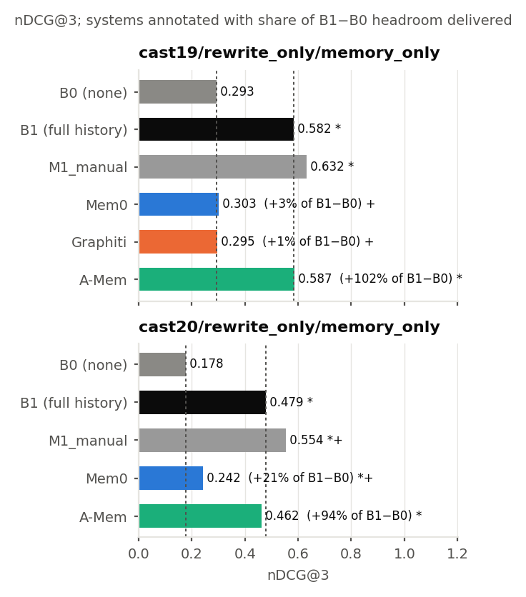

# Does Memory Transfer to Ranking?

**Extrinsic evaluation of agent memory systems on conversational search**

[](https://wsdm-conference.org/2027/)
[](LICENSE)
[](https://www.python.org/)

Siu Hin Ng · *The 20th ACM International Conference on Web Search and Data Mining (WSDM 2027), Hong Kong*

Agent memory systems such as Mem0, Graphiti, A-Mem and GAM are compared and adopted almost
entirely on conversational question-answering recall. This repository measures something else:
whether the memory they build helps a retrieval system **rank documents** for the user. It replays
TREC CAsT 2019 and 2020 dialogues turn by turn through each shipped system, behind a frozen
rewrite-and-retrieve pipeline, and scores the ranking that each system's memory causes.

<p align="center">
  
</p>

## Results

nDCG@3 on judged turns (173 on CAsT 2019, 208 on CAsT 2020) under the memory-only design.
**% of M1** is each condition's share of the gain that the track's own manual rewrites (M1) achieve
over no memory (B0).

| Condition | 2019 nDCG@3 | % of M1 | 2020 nDCG@3 | % of M1 |
|---|---:|---:|---:|---:|
| M1 manual rewrites (human reference) | 0.6323 | 100% | 0.5544 | 100% |
| B1 full conversation history | 0.5824 | 85.3% | 0.4790 | 80.0% |
| **A-Mem** | **0.5870** | **86.6%** | **0.4615** | **75.4%** |
| Mem0 | 0.3026 | 2.8% | 0.2422 | 17.1% |
| Graphiti | 0.2954 | 0.7% | not run | |
| B0 no memory | 0.2930 | 0% | 0.1777 | 0% |

Bold marks the best memory system, not the best row.

- **A-Mem's verbatim notes preserve essentially all of the gain** that full conversational context
  is worth.
- **Mem0's extracted facts preserve little of it, by omission.** Its personal-fact extractor stores
  nothing on 82–91% of information-seeking turns. Turning extraction off inside the same library
  recovers 92–95% of the full-history gain.
- **Two systems produced plausible runs while storing nothing.** Graphiti's graph holds episodes
  but no facts on this collection, and GAM's POSIX-only file operations reported success on Windows
  while writing nothing. Report *injection rate*, the fraction of turns on which memory changed the
  query at all, before reading any null result.

## Installation

```bash
git clone https://github.com/mnsh0409/memory-transfer-harness.git
cd memory-transfer-harness
pip install -r requirements.txt      # Python 3.10
```

## Reproducing the paper

Every reported number is computed from the per-turn metrics in `runs/metrics/` and the cached
model calls in `runs/llm_cache.release.jsonl`. The whole analysis reruns in minutes with no API key
and no GPU. Outputs regenerate in place, so `git status` is the check: it should show nothing
changed. Run `make_figures` with `SOURCE_DATE_EPOCH=1767225600` set, or the PDFs will differ by
their embedded timestamps.

| Paper | Command |
|---|---|
| Tables 1 and 3, every significance test | `python -m scripts.collect_stats` |
| Figures 2–4 | `python -m scripts.make_figures` |
| Injection rates | `python -m scripts.injection_report` |
| Judge validation, κ = 0.40 (Section 5.5) | see below |
| Intervals on the delivered shares, effective sample size | `python -m scripts.share_inference` |

```bash
python -m scripts.judge_agreement \
    manual_check/ikat23.B1_full_history.rewrite_only.9bb5493cda8a.annotated.csv \
    --judged manual_check/ikat23.B1_full_history.rewrite_only.9bb5493cda8a.csv
```

Two analyses also need the public CAsT topics and qrels, which are a few MB and need no credentials:

```bash
bash scripts/fetch_free_data.sh
python -m scripts.decompose_treated                                         # Section 6.2
python -m scripts.pool_robustness --collection cast19 --context memory_only # Table 2; needs the runs below
```

## Released runs

The 24 TREC run files are attached to the
[v1.0.0 release](https://github.com/mnsh0409/memory-transfer-harness/releases/tag/v1.0.0)
(192 MB) instead of being stored in git:

```bash
curl -LO https://github.com/mnsh0409/memory-transfer-harness/releases/download/v1.0.0/trec_runs.tar
tar -xf trec_runs.tar                # -> runs/trec_gz/*.run.gz
```

`SHA256SUMS.txt` in the same release covers the archive and every run file (`sha256sum -c
SHA256SUMS.txt`). To check our numbers with your own `trec_eval` instead of trusting ours,
decompress the runs and score them against the official qrels from `fetch_free_data.sh`:

```bash
mkdir -p runs/trec && for f in runs/trec_gz/*.gz; do gunzip -c "$f" > "runs/trec/$(basename "$f" .gz)"; done
trec_eval -m ndcg_cut.3 data/cast/cast19_qrels.txt runs/trec/cast19.B1_full_history.rewrite_only.a2007d8bf562.run
# ndcg_cut_3   all   0.5824     (Table 1, B1 on CAsT 2019)
```

Each file is named `<collection>.<condition>.<injection>.<run id>.run`, and
`runs/stats_summary.json` maps every run ID to its condition and settings. The same scoring gives
0.3026 for `cast19.S1_mem0.rewrite_only.2f1244a911df` and 0.4615 for
`cast20.S3_amem.rewrite_only.167d9cc846da`. `run_eval` will not rescore over the committed
metrics: run artifacts are append-only, so a changed config gets a new run ID instead.

## Re-running the experiments

This needs Java 21+, Pyserini's `cast2019` prebuilt index (about 19.8 GiB), the versions in
`requirements.lock`, and a `.env` file:

```bash
OPENAI_API_KEY=...
EXPERIMENT_MODEL=gpt-4o-mini-2024-07-18      # one pinned snapshot serves every role
```

```bash
bash scripts/preflight.sh --index    # checks the machine; pulls the index
python -m scripts.make_grid          # writes every condition's config to runs/configs/
python -m scripts.run_replay    --config runs/configs/<name>.json --cache runs/llm_cache.release.jsonl
python -m scripts.run_retrieval --config runs/configs/<name>.json
python -m scripts.run_eval      --config runs/configs/<name>.json
```

Rewrites and judge decisions replay from the cache without spending anything. Mem0 and Graphiti
open model connections of their own that the harness cannot route, so re-running those two systems
needs a key and spends budget.

## Adding a memory system

Implement the four-method contract in `src/harness/memory_base.py`, then add a branch for your
condition to `make_memory_system()` in `src/harness/registry.py`:

```python
from harness.memory_base import MemoryEntry, MemorySystem, Turn

class MyMemory(MemorySystem):
    name = "S9_mine"

    def ingest_turn(self, dialogue_id: str, turn: Turn) -> None: ...
    def query(self, dialogue_id: str, utterance: str, k: int) -> list[MemoryEntry]: ...
    def reset(self, dialogue_id: str) -> None: ...
    def export_store(self, dialogue_id: str) -> list[MemoryEntry]: ...  # a true dump, not a search
```

The replay calls `query()` before it ingests the current turn, keeps every dialogue's store
separate, and renders entries as text only, so no system's native structure gets a prompt
advantage. [ARCHITECTURE.md](ARCHITECTURE.md) gives the design and the invariants that the tests
enforce.

## Repository layout

```
src/harness/       replay protocol, MemorySystem contract, baselines, LLM cache, retrieval, TREC I/O
src/adapters/      one adapter per memory system: Mem0, Graphiti, A-Mem, GAM
src/eval/          extrinsic and intrinsic scoring, statistics, figures
scripts/           data fetch, the four-stage pipeline, analyses, batch drivers
prompts/           the frozen rewrite and judge instruments
tests/             offline test suite
manual_check/      the human-annotated sample behind the judge validation
runs/metrics/      per-turn scores for every run; what the statistics and figures read
runs/configs*/     the frozen specification of every condition
runs/rewrites/     the standalone query each condition produced, turn by turn
runs/stats/        computed comparisons, significance tests, summaries
runs/llm_cache.release.jsonl   every harness-mediated model call, content-hashed
```

## Tests

```bash
python -m pytest -q
```

The suite runs offline. Tests that need fetched data or optional libraries skip themselves.

## License

The code is released under the [MIT License](LICENSE). Third-party terms still apply to what the
pipeline uses:

- The cross-encoder, `naver/trecdl22-crossencoder-debertav3`, is released by its authors under
  CC-BY-NC-SA-4.0, which restricts commercial use of the retrieval stack but not of the harness.
- TREC CAsT topics and qrels are fetched from the organizers' repository and are not redistributed
  here.
- No ClueWeb22 or iKAT passage text appears anywhere in this repository. The LLM cache contains
  prompts over public CAsT topic text and iKAT PTKB text only.

## Citation

```bibtex
@inproceedings{ng2027memory,
  author    = {Ng, Siu Hin},
  title     = {Does Memory Transfer to Ranking? Extrinsic Evaluation of Agent Memory Systems
               on Conversational Search},
  booktitle = {Proceedings of the 20th ACM International Conference on Web Search and Data
               Mining (WSDM '27)},
  year      = {2027},
  address   = {Hong Kong},
  publisher = {ACM}
}
```
